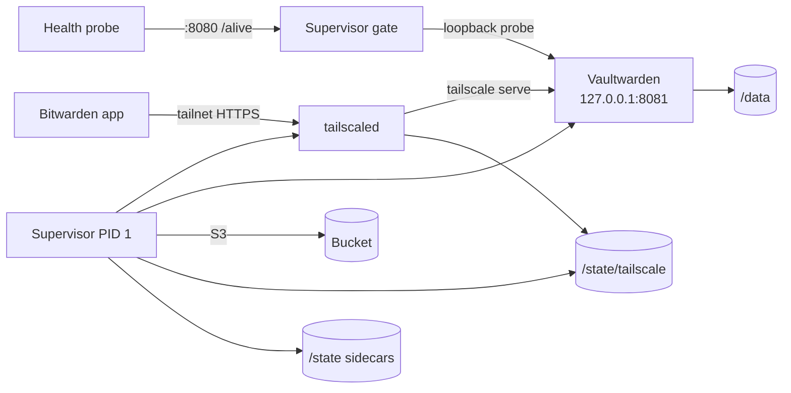

# Architecture

One container runs three processes: the supervisor as PID 1, `tailscaled`
(plus short-lived `tailscale` CLI commands), and Vaultwarden. Tailscale is the
only ingress; the vault never listens on a public interface.

## Processes and identities

| Process | UID:GID | Groups | Capabilities | Writable paths |
| --- | --- | --- | --- | --- |
| supervisor (PID 1) | `65532:65532` | `tailscale` (`65531`) | `SETUID`, `SETGID`, `KILL`, `DAC_READ_SEARCH` | `/state`, `/tmp`; reads `/data` |
| `tailscaled` | `65531:65531` | `tailscale` (`65531`) | none in userspace mode; `NET_ADMIN` and sometimes `NET_RAW` in TUN mode | `/state/tailscale` |
| `tailscale` CLI | `65532:65532` | `tailscale` | none | none |
| Vaultwarden | `65533:65532` | none | none | `/data` |

The supervisor keeps four capabilities:

- `SETUID` and `SETGID` start each child under its own identity;
- `KILL` stops children that changed uid;
- `DAC_READ_SEARCH` reads tailscaled's `0600` identity and certificate files
  for state sync.

Every child is spawned with `no_new_privs` set. Capabilities are cleared, except
the TUN network pair for tailscaled. The vault's uid is not in the `tailscale`
group, so it cannot traverse `/state`, reach the LocalAPI socket, or read the
dotenv file.

## Volumes and modes

| Path | Mode | Owner | Contents |
| --- | --- | --- | --- |
| `/data` | `0770` | `65532:65532` | SQLite database, signing keys, `config.json`, attachments, Sends |
| `/state` | `2710` | `65532:65531` | Supervisor sidecars, backup staging, dotenv file |
| `/state/tailscale` | `2770` | `65532:65531` | tailscaled identity, certificate cache, LocalAPI socket |
| `/state/tailscale-state` | symlink | — | Points at `/state/tailscale`; used only for `tailscaled --state` |

`/state` is group-traversable but not listable. The vault runs as a different
uid and is not in the group, so it cannot enter. tailscaled can write only its
own subtree.

The differently named `tailscale-state` link exists because Tailscale changes a
state directory named exactly `tailscale` to `0700`. The daemon uid cannot do
that on the supervisor-owned tree and would silently fall back to an in-memory
identity. The link gives Tailscale a directory name it will leave alone.

`/tmp` is a shared tmpfs in the compose layout; the table lists persistent
paths.

## Network path

- The gate binds the configured public port (`VAULTWARDEN_PORT`, default
  `8080`) on the container interface. It answers only `/alive`: `200` when the
  vault answers, `503` when it does not, `403` for every other path. Handler
  threads are capped and verdicts are cached; denied requests are not logged.
- Vaultwarden binds `127.0.0.1` on the next port (`8081` by default). It is not
  reachable from the container network or the host.
- `tailscale serve` terminates tailnet HTTPS and proxies to the vault. With
  MagicDNS and HTTPS certificates enabled, the address is
  `https://<hostname>.<tailnet>.ts.net`.
- Userspace networking is the default and needs no extra privileges. TUN mode
  is slightly faster but needs `NET_ADMIN`, sometimes `NET_RAW`, and
  `/dev/net/tun`. Rootless Podman cannot create a TUN in its user namespace.

## Boot sequence

Before the phase table, the supervisor installs signal handlers, joins the
`tailscale` group, and migrates an old `/data` layout. Config resolution
follows, then these phases:

| Phase | Purpose | On stop | On failure |
| --- | --- | --- | --- |
| `AdoptLineage` | Let a non-empty upgraded DB adopt the bucket's newest backup generation | skip | never fails |
| `RestoreDb` | Restore the newest usable dump into an empty DB | exit `0` | exit `1`; never start on partial state |
| `RestoreState` | Pull missing durable files from S3 | skip | log and continue |
| `Tailscaled` | Start the daemon | exit `0` | exit `1` |
| `DaemonWait` | Wait for the LocalAPI socket | exit `0` | exit `1` |
| `TailscaleUp` | Join the tailnet and push the identity | exit `0` | exit `1` |
| `Serve` | Publish the vault over tailnet HTTPS | exit `0` | exit `1` |
| Vault | Run the vault watch loop for the container's lifetime | owns shutdown | exits with the vault's code |

No Tailscale, no vault. A boot-phase failure tears down what exists and exits
without a final state push: nothing durable has changed yet.

## Shutdown

The watch loop owns teardown. A stop signal (`SIGTERM`, `SIGINT`, `SIGHUP`, or
`SIGQUIT`) is observed by the main thread, which sends `SIGTERM` to each child
process group and escalates to `SIGKILL` after 10 seconds. Reaping is bounded,
so an unresponsive child cannot hold the container open forever.

After the children exit, the maintenance thread runs the final persists in
order: database dump, then state push. The budget is 120 seconds, shortened to
15 seconds when a second stop signal arrives. Compose allows 180 seconds
(`stop_grace_period`), which covers the normal path. A `SIGKILL` from the
orchestrator skips the final cycle; the next start recovers from the bucket.

## Security model

The container assumes the vault process may be compromised and limits what it
can reach:

- The vault cannot traverse `/state`, read the dotenv file, reach the LocalAPI
  socket, or signal another process.
- tailscaled can write its own state subtree and reach the tailnet, but cannot
  read `/data`, the dotenv file, the backup staging area, or the sync sidecars.
- The supervisor holds the capabilities; no child inherits them.
- The public port exposes one read-only health answer and nothing else.

The S3 bucket is outside the container boundary and is part of the security
model. It holds the node identity, the vault signing key, and user files.
Anyone who can write to it can plant a file that looks like a backup. Use a
dedicated key scoped to the bucket or prefix, keep versioning or object lock
where available, and run one container per bucket.

`.env` permissions are checked and warned about, not enforced: a
world-readable file is visible to the tailscaled group through `/state`
traversal. `0600` owner `65532` is the strict choice.

Fail-closed rules:

- a missing auth key, identity, or usable S3 restore refuses the vault;
- a mid-run tailscaled death tears the vault down;
- an uncertain restore refuses the boot instead of guessing;
- a state push that cannot prove the bucket complete is refused;
- an unknown supervisor key or an unusable path refuses the boot;
- a gate that cannot bind exits the container.
